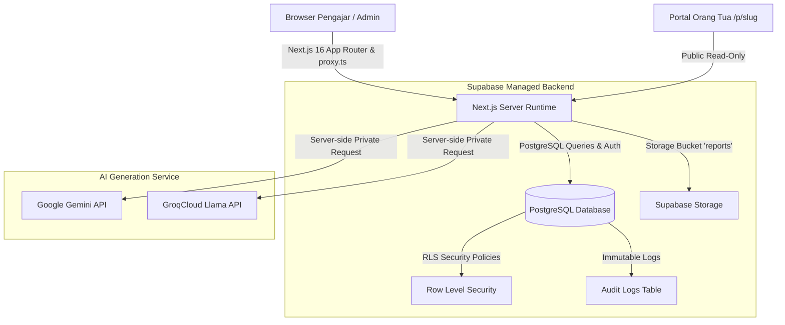

# Daely Report Studio

> Sistem otomasi laporan progres belajar murid cerdas bertenaga AI untuk lembaga kursus, bimbel, dan pengajar privat — dilengkapi dengan portal publik interaktif untuk orang tua murid.
>
> *Smart AI-powered student evaluation and learning progress reporting system for tutoring centers, academies, and private instructors — featuring an interactive public portal for parents.*

[](LICENSE)
[](https://nextjs.org/)
[](https://supabase.com/)
[](https://www.typescriptlang.org/)

---

### 📚 Dokumentasi & Panduan Resmi / Official Guides

- 🇮🇩 **[Panduan Bahasa Indonesia (`docs/guides/id/`)](docs/guides/id/)**
  - [Panduan Lengkap Implementasi dari Nol (Zero to Production)](docs/guides/id/GUIDELINE_IMPLEMENTASI_DARI_NOL.md)
  - [Panduan White-Label & Kustomisasi Brand](docs/guides/id/WHITE_LABEL_GUIDE.md)
- 🇬🇧 **[English Documentation (`docs/guides/en/`)](docs/guides/en/)**
  - [Zero to Production Implementation Guide](docs/guides/en/ZERO_TO_PRODUCTION_GUIDE.md)
  - [White-Labeling & Brand Customization Guide](docs/guides/en/WHITE_LABEL_GUIDE.md)

---

## 1. Arsitektur Sistem / System Architecture



---

## 2. Fitur Unggulan Komersial

- **Mesin Generate Laporan AI Few-Shot**: Menghasilkan draf laporan terstruktur (Overview, Catatan Guru, Rekomendasi Latihan, dan Catatan Orang Tua) dengan gaya bahasa alami yang meniru contoh dataset Anda.
- **Portal Publik Interaktif Wali Murid (`/p/[slug]`)**: Halaman transparan dan elegan bagi orang tua untuk memantau progres belajar, sorotan foto dokumentasi, riwayat pertemuan, dan mengirim masukan balik tanpa perlu login.
- **Dukungan Multibahasa Instan (i18n)**: Beralih mulus antara Bahasa Indonesia (ID) dan Bahasa Inggris (EN) yang tersimpan per profil pengajar (`user_metadata`).
- **Arsitektur Keamanan Berlapis (Security-Hardened)**:
  - Row Level Security (RLS) PostgreSQL untuk isolasi multi-tenant data antar guru.
  - Kunci API AI diamankan secara eksklusif di server runtime (`SUPABASE_SERVICE_ROLE_KEY` / `AI_API_KEY`).
  - Proteksi Rate Limiting *sliding-window* in-memory (10 request/menit per pengguna) dan validasi batas input.
  - Query portal publik terindeks $O(1)$ untuk kecepatan akses dan pencegahan kebocoran data murid lain.
- **Alur Deoffboarding Aman (*Safe Deoffboarding Workflow*)**: Mencegah data murid menjadi yatim (*orphan*) dengan mewajibkan pengalihan seluruh murid aktif ke guru pengganti sebelum akun instruktur dihapus.
- **Tabel Jejak Audit Administrasi (*Audit Logs Activity Trail*)**: Catatan *immutable append-only* pada tabel `public.audit_logs` untuk memantau transfer murid, pembaruan API key AI, manajemen guru, dan penghapusan data.
- **Konvensi Modern Next.js 16 (`proxy.ts`)**: Menerapkan konvensi resmi Next.js 16 `src/proxy.ts` menggantikan `middleware.ts` lama.
- **White-Label Ready**: Mudah di-*rebrand* menjadi nama dan logo lembaga Anda sendiri dalam hitungan menit.

---

## 3. Panduan Instalasi Cepat (Quickstart)

### Prasyarat Sistem
- Node.js versi `20.x` LTS atau lebih baru
- npm, pnpm, atau yarn
- Akun gratis di [Supabase](https://supabase.com/)
- Akun gratis di [Google AI Studio](https://aistudio.google.com/) (untuk API Key Gemini)

---

### Langkah 1: Kloning & Instalasi Dependensi
```bash
git clone https://github.com/revanzaRaihan/daereport.git
cd daereport
npm install
```

---

### Langkah 2: Setup Database Supabase
1. Buat project baru di [Supabase Dashboard](https://supabase.com/dashboard).
2. Buka menu **SQL Editor** pada project Supabase Anda.
3. Buka file [`supabase/schema.sql`](supabase/schema.sql) di repositori ini, salin seluruh isinya, tempel (*paste*) ke SQL Editor, dan klik **Run**.
4. Jalankan skrip migrasi terbaru di [`supabase/migrations/`](supabase/migrations/) (termasuk `20261008_create_audit_logs_activity_trail.sql`).
5. Buka menu **Storage** -> **New Bucket**:
   - Beri nama bucket: `reports`
   - Aktifkan opsi **Public bucket** (agar foto dokumentasi dapat dimuat di portal orang tua).

---

### Langkah 3: Konfigurasi Environment Variable
Salin file template `.env.example` menjadi `.env.local`:
```bash
cp .env.example .env.local
```

Buka `.env.local` dan lengkapi nilainya:
```env
# Dapatkan di Supabase Dashboard -> Project Settings -> API
NEXT_PUBLIC_SUPABASE_URL=https://xxxxxxxxxxxxxxxxxxxx.supabase.co
NEXT_PUBLIC_SUPABASE_ANON_KEY=eyJhbGciOiJIUzI1NiIsInR5c...
SUPABASE_SERVICE_ROLE_KEY=eyJhbGciOiJIUzI1NiIsInR5c...

# Kredensial AI (Google AI Studio)
AI_PROVIDER=gemini
AI_MODEL=gemini-2.5-flash
AI_API_KEY=AIzaSy...

# Branding & Notifikasi
NEXT_PUBLIC_APP_NAME="Nama Lembaga Anda"
NEXT_PUBLIC_BRANCH_ADMIN_EMAIL=admin@lembagaanda.com
```

---

### Langkah 4: Menjalankan Aplikasi
Jalankan server pengembangan lokal:
```bash
npm run dev
```
Buka browser pada [http://localhost:3000](http://localhost:3000).

---

## 4. Cara Membuat Akun Administrator Pertama (Bootstrap Admin)

Karena pendaftaran publik mandiri telah ditutup demi keamanan kuota AI dan privasi murid, akun administrator pertama dibuat secara langsung:

1. Buka **Supabase Dashboard** -> **Authentication** -> **Users** -> **Add User** -> **Create User**.
2. Masukkan email admin Anda (misal `admin@lembaga.com`) dan buat password. Centang *Auto Confirm User*.
3. Buka **SQL Editor** pada Supabase Dashboard dan jalankan:
   ```sql
   UPDATE auth.users
   SET raw_app_meta_data = raw_app_meta_data || '{"role": "admin"}'::jsonb
   WHERE email = 'admin@lembaga.com';
   ```
4. Login di `/login` dengan akun tersebut. Akun Anda kini resmi memiliki status **Super Admin** terlindungi (*anti-tampering*).
5. Untuk menambah staf/guru pengajar lainnya, gunakan menu **Instruktur (`/instructors`)** untuk mengirimkan tautan aktivasi mandiri.

---

## 5. Lisensi Perangkat Lunak

Aplikasi ini dilindungi oleh lisensi komersial kepemilikan tunggal. Pembeli berhak mengoperasikan, memodifikasi, dan men-*deploy* kode sumber untuk kepentingan internal institusi atau klien tunggal, namun dilarang keras menjual kembali atau menyebarluaskan kode sumber secara bebas.

Detail lengkap hak dan batasan tercantum pada file [LICENSE](LICENSE).
